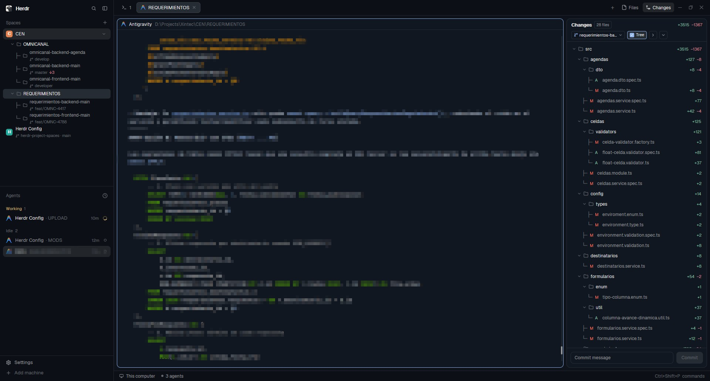

# Herdr Project Spaces & Changes

A developer layout and 2-mod suite for [Herdr](https://herdr.dev) that brings hierarchical multi-repo space navigation and a Zed-inspired Changes panel with multi-repo switching and auto-hiding diffs.



## Overview

Working in monorepos, microservices, or folder trees with multiple git repositories often clutters traditional terminal workspaces. This suite provides:

1. **`mods/project-spaces`**:
   - Automatically discovers git repositories within your active space directory (up to depth 2 or customized).
   - Renders a clean hierarchical tree view with tree glyphs (`├─`, `└─`) and folder groupings.
   - Live branch badges and sync indicators (ahead/behind commits, uncommitted changes).
   - Single-click to focus or split a pane directly in the subrepo's folder.
   - Right-click context menu with split options, path copying, and an integrated **Branch Switcher** modal dialog with real-time fuzzy filtering and one-click checkout.

2. **`mods/project-changes`**:
   - **Zed-Style Multi-Repo Dropdown**: When working in a multi-repo space, quickly toggle between repositories from the Changes panel header.
   - **Folder Tree of Changes**: Hierarchical staged, unstaged, and untracked file listings with aggregate counts and bulk expand/collapse.
   - **Auto-Hiding Diff Viewer**: Highlights additions, deletions, and unified diff hunks. Automatically collapses when no file is selected to give maximum vertical space to the file tree.

3. **`layouts/project-spaces.json`**:
   - A complete window layout tying `project-spaces` and `project-changes` together seamlessly with Herdr's default chrome, agent list, and tab strip.

---

## 1-Click Installation with Herdr Agents

In Herdr, you can paste this instruction to your coding agent:

```text
Read ~/.config/herdr-app/AGENTS.md, then add this layout: https://github.com/Opsord/herdr-mods
```

The agent will copy `layouts/project-spaces.json` to your `layouts/` directory, copy both mods to `mods/`, run `herdr-app check`, and switch to the new layout.

---

## Manual Installation

1. Clone or download this repository:
   ```bash
   git clone https://github.com/Opsord/herdr-mods.git
   ```

2. Copy or symlink the mods into your Herdr configuration folder (`~/.config/herdr-app` or `%USERPROFILE%\.config\herdr-app` on Windows):
   ```bash
   # Copy mods
   cp -r mods/project-spaces ~/.config/herdr-app/mods/
   cp -r mods/project-changes ~/.config/herdr-app/mods/

   # Copy layout
   cp layouts/project-spaces.json ~/.config/herdr-app/layouts/
   ```

3. Verify both mods with `herdr-app`:
   ```bash
   herdr-app check ~/.config/herdr-app/mods/project-spaces
   herdr-app check ~/.config/herdr-app/mods/project-changes
   ```

4. Switch to the layout:
   ```bash
   herdr-app do layout.switch '{"name": "project-spaces"}'
   ```
   *(Or press `ctrl-shift-l` to cycle layouts)*

---

## Configuration

To customize scanning depth or exclusions for `project-spaces`, create a `subrepos.json` file in your workspace directory (see `subrepos.json.example`):

```json
{
  "max_depth": 2,
  "exclude": [
    "node_modules",
    "dist",
    "target",
    ".venv",
    "vendor",
    ".cache",
    "build",
    ".next"
  ]
}
```

---

## Contributing to Herdr Community Gallery

This repository is formatted following the official Herdr specification:
- Layout in `layouts/<name>.json`
- Mods in `mods/<name>/`
- `RECIPE.md` for zero-setup replication
- `preview.png` rendered from real Herdr frame buffers
- Tagged with topics `herdr-layout` and `herdr-mod` on GitHub

---

## License

MIT License. See [LICENSE](LICENSE) for details.
