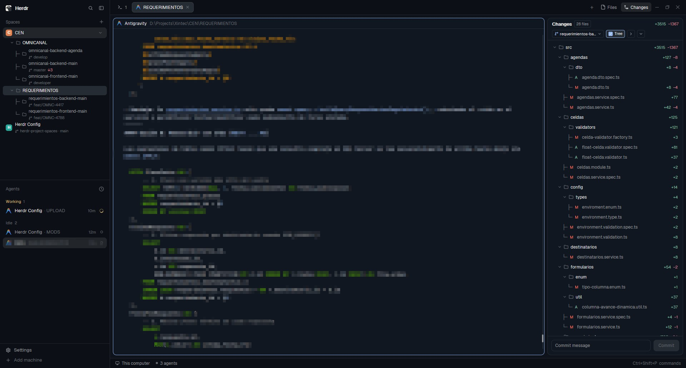

# Project Spaces & Changes

A cohesive, developer-centric layout and 2-mod suite for Herdr featuring hierarchical multi-repository spaces with branch pickers and a Zed-inspired Changes panel with multi-repo switching and auto-hiding diff view.

## What you see

The interface is structured as an integrated workspace consisting of three primary zones:

1. **Left Sidebar (268px, background `chrome`)**:
   - **Header Brand (`workspace-chrome`)**: Workspace identity and window dragging area.
   - **Project Spaces (`mods/project-spaces/`)**: Spaces grouped by machine. For spaces containing multiple git repositories or nested subfolders, displays an expandable hierarchical tree with branch badges (`main`, `feature/xyz`), ahead/behind commit sync counters, uncommitted change indicators, and clean branch glyphs (`├─`, `└─`). Clicking a subrepo focuses or opens a split pane in that folder; right-clicking opens a context menu with options to split panes or launch a branch switcher.
   - **Agents (`agents`)**: Active agent sessions with status indicators.
   - **Footer (`workspace-chrome`, props `footer: true`)**: Settings, notifications, and user status.
2. **Main Work Area (flexible, background `canvas`)**:
   - **Tab Bar (`tabs`)**: Pills for active terminal tabs and splits.
   - **Active Pane Block (`tab: "active"`)**: Pane cards framed with headers (`mod: "pane"`, reveal `always`, height 30px, radius 10px, gap 8px).
   - **Status Bar (`workspace-status`)**: Bottom status line (28px).
3. **Right Panel (368px, resizable 280-900px, background `surface`)**:
   - **Changes & Files Stack (`mods/project-changes/` & `files`)**:
     - **Multi-Repo Dropdown**: When a space contains multiple sub-repositories, a Zed-style repository dropdown selector at the top allows switching the active git scope seamlessly.
     - **Staged / Unstaged Section Controls**: Bulk stage (`+`), unstage (`-`), and bulk folder collapse/expand controls.
     - **Status Tree**: File list categorized by status (`M` modified, `A` added, `D` deleted, `?` untracked).
     - **Dynamic Diff Viewer**: When a modified file is clicked, an integrated diff viewer slides into view with syntax-colored hunk headers, additions, and deletions. When no file is selected, the diff viewer collapses completely, granting 100% of vertical height to the changes file tree.

## How it behaves

- **Agent Statuses**:
  Inherits Herdr's core agent states (`working`, `blocked`, `idle`, `done`). Badges in the sidebar and pane headers reflect agent statuses with reactive color coding (accent amber for blocked, green for done, blue/pulsing for working).
- **Subrepo Hierarchy & Navigation**:
  - Clicking a space header switches to that space (`space.switch`).
  - Clicking the subrepo counter chevron toggles folding/expansion of nested repositories.
  - Hovering over a subrepo reveals action triggers.
  - Clicking a subrepo checks open panes: if a terminal already runs in that subrepo's directory, it focuses that pane (`pane.focus`); otherwise, it splits a new pane (`pane.split`) or opens a tab rooted in that subrepo directory.
  - Right-clicking a subrepo opens a pointer context menu overlay (`role: "menu"`) with options: *Split pane here*, *Open new tab*, *Switch branch*, and *Copy path*.
  - Selecting *Switch branch* opens a modal dialog (`role: "branch-switcher"`) with a real-time search filter. Pressing Enter or clicking a branch runs `git checkout <branch>` in the background and refreshes the space tree.
- **Multi-Repo Changes Panel**:
  - Automatically indexes git repositories in the current space. If multiple subrepos are present, renders a repository selector dropdown.
  - Selecting a repository switches the git working directory scope instantly.
  - Clicking individual files toggles their diff preview. Clicking an already selected file or an empty area unselects it, automatically hiding the diff panel to reclaim space.
  - Staging files runs `git add`; unstaging runs `git restore --staged`.

## Built from

- **Layout (`layouts/project-spaces.json`)**:
  - Cloned from `main` (version `0.1.13`).
  - Root `row` containing `sidebar` column (268px), `work` column, `work-body` row, and `panel` column (368px) housing the stacked `files` and `project-changes` blocks.
- **Mod 1: `mods/project-spaces/`**:
  - `main.js`: Main tree view using GPUI kit (`div()`, flex layout, virtual rendering, `on_click`, `on_mouse_down`). Implements Herdr's role pattern to delegate to internal roles:
    - Default: Spaces tree view with nested subrepos and live branch tracking.
    - `role: "menu"` (`menu.js`): Floating context menu overlay for subrepo actions.
    - `role: "branch-switcher"` (`branch-switcher.js`): Modal overlay for filtering and switching git branches.
  - `scan.ps1`: Recursive directory scanner finding git roots up to depth 2, ignoring non-project directories (`node_modules`, `dist`, `target`, `.venv`, etc.).
  - `mod.json`: Configured with overlay definitions for `menu` and `branch-switcher`.
- **Mod 2: `mods/project-changes/`**:
  - `main.js`: Git changes inspector with Zed-style multi-repo selector, tree view with expandable directories, bulk collapse/expand state, staging controls, and conditional diff display.
  - `scan.ps1`: Git status parser returning staged, unstaged, and untracked file entries.
  - `changes.svg`: Mod header icon.
- **Herdr Core & Native Integration**:
  - Reads `spaces()`, `panes()`, `theme()`.
  - Runs commands: `space.switch`, `tab.open`, `pane.split`, `pane.focus`.
  - Uses `openOverlay()` and `closeOverlay()` for modal and context popups.
  - Executes shell utilities via `exec()`.

## Watch out

- **Element ID Collisions**: Repositories across different folders can share names (e.g. `client`, `api`, `web`). GPUI element IDs must sanitize the relative path (e.g. `subrepo-${space.id}-${cleanRelPath}`) to prevent element reuse bugs.
- **Scan Throttling**: Scanning directories and git branches on every frame causes terminal stutter. Background checks must be debounced with timestamp caching (`subreposChecked`) and skipped during active scans.
- **Windows Path Normalization**: Mixed directory separators (`\` vs `/`) between PowerShell, Git, and Herdr's `pane.cwd` require uniform casing and backslash normalization before equality checks.
- **Diff Auto-Hiding**: When no file is selected, the diff viewer must return `null` and its container must collapse gracefully without leaving orphaned flex gaps.

## Done when

- [x] `herdr-app check mods/project-spaces` passes with exit code 0.
- [x] `herdr-app check mods/project-changes` passes with exit code 0.
- [x] Spaces containing nested git repositories show an expandable tree with branch names and sync status.
- [x] Right-clicking a nested repository brings up the context menu, and clicking "Switch branch" opens the branch modal.
- [x] Selecting a different branch checks out the branch cleanly and updates the tree branch label.
- [x] Changes panel renders the repository dropdown when multiple repos exist in the active space.
- [x] Unselected diff view collapses entirely to allow full-height change tree navigation.
